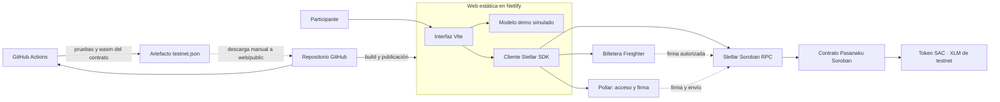
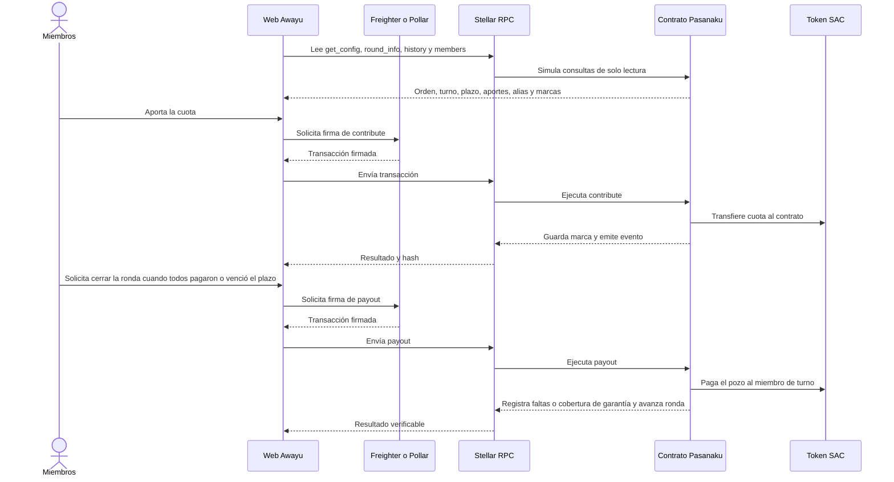

# Arquitectura de Awayu

## Componentes

Netlify publica el build estático de `web/`. Sin un despliegue de testnet cargado, la interfaz puede funcionar en el modo demo local. El flujo de testnet lee `testnet.json` para conocer RPC, token y contrato. GitHub Actions prueba y compila el contrato; el workflow manual crea un círculo de prueba y entrega `testnet.json` como artefacto para descargar a `web/public/` antes de publicar ese despliegue.

Freighter y Pollar firman acciones autorizadas por el participante. La lectura del estado del círculo se hace mediante Stellar RPC; las operaciones firmadas se envían y se consultan hasta su resultado. Pollar está habilitado solo cuando se configura `VITE_POLLAR_KEY`.

## Flujo de una ronda

El contrato permite que cualquier cuenta invoque `payout()` cuando ya aportaron todos o venció el plazo. El orden de cobro se fija al crear el círculo mediante el PRNG de la red. Si alguien no aportó y dejó una garantía suficiente, esa garantía cubre la cuota; si no, queda la marca de falta. El aguayo 3D se construye en la web a partir de las marcas. En el modo demo esos cambios son solo estado local simulado.
